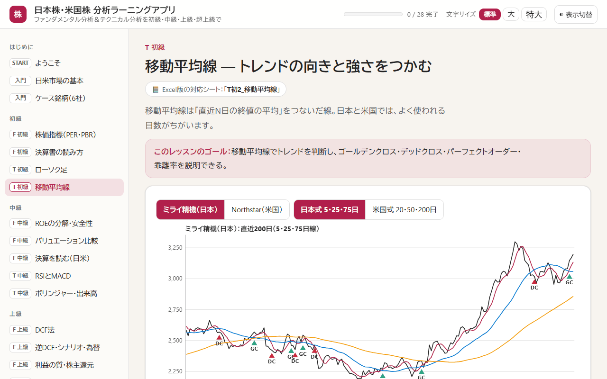
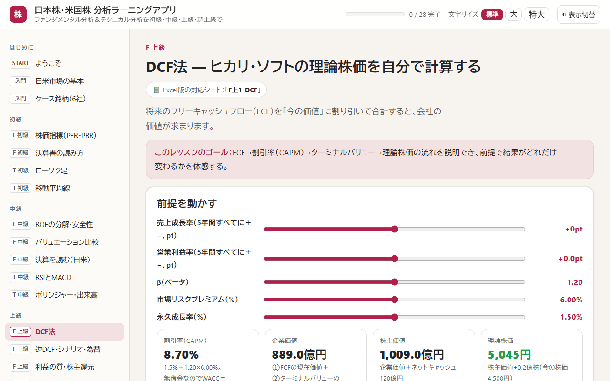

# 日本株・米国株 分析ラーニングツール

株の分析を、**初級 → 中級 → 上級 → 超上級** の順に、日本株と米国株の両方で学ぶ教材です。会社の「価値」を読むファンダメンタル分析（F）と、株価の「流れ」を読むテクニカル分析（T）の両方を、架空の会社のデータで、グラフや計算機を動かしながら身につけます。

> **English summary:** A Japanese course on stock analysis for both Japanese and US equities, from beginner to expert level. It covers fundamental analysis (valuation multiples, financial statements, ROE, DCF and reverse DCF, earnings quality, credit risk, ROIC/EVA, SOTP) and technical analysis (candlesticks, moving averages, RSI, MACD, Bollinger Bands, Ichimoku, Fibonacci, ATR, backtesting) with interactive charts. Includes a single-file offline HTML app (25 lessons, 44-question test, 94-term glossary) and a self-checking Excel workbook. All companies and prices are fictional; this is not investment advice.

  

| 項目 | 内容 |
|---|---|
| 学習アプリ | 全28ページ（レッスン25、確認テスト44問、用語集94語） |
| Excel ワークブック | 30シート |
| 題材 | 架空の日米6社＋要注意の1社、2銘柄・400営業日分の株価 |

## 目次

- [この教材でわかること](#この教材でわかること)
- [すぐに始める](#すぐに始める)
- [収録ファイル](#収録ファイル)
- [教材に出てくる会社（すべて架空）](#教材に出てくる会社すべて架空)
- [カリキュラム](#カリキュラム)
- [学び方](#学び方)
- [動作環境](#動作環境)
- [よくある質問](#よくある質問)
- [注意事項](#注意事項)
- [利用について](#利用について)
- [このシリーズのほかの教材](#このシリーズのほかの教材)

## この教材でわかること

- **ファンダメンタル分析**：PER・PBR、決算書の読み方、ROE の分解と安全性、バリュエーションの比較、DCF 法と逆 DCF、利益の質と株主還元、倒産リスクと信用力、会計の危険信号、ROIC・EVA・残余利益、SOTP、企業分析レポートの書き方
- **テクニカル分析**：ローソク足、移動平均線（日本式・米国式）、RSI と MACD、ボリンジャーバンドと出来高、一目均衡表・フィボナッチ・ATR、バックテスト
- **総合**：銘柄分析スコアカード、リスク管理、ポートフォリオの組み方

**こんな人に向いています**

- 日本株・米国株の投資を、根拠をもって判断できるようになりたい人
- 決算書の数字と株価の動きを、両方の視点から読めるようになりたい人
- 企業分析やバリュエーションの考え方を、手を動かして身につけたい人

## すぐに始める

インストールもアカウント登録もいりません。

1. このページの上にある緑色の **［Code］** ボタン → **［Download ZIP］** で、ファイル一式をダウンロードします。
2. ダウンロードした ZIP ファイルを展開します（Windows は右クリック → **［すべて展開］**、Mac はダブルクリック）。
3. **`株式投資_分析アプリ.html`** をダブルクリックすると、ブラウザで学習アプリが開きます。
4. **`株式投資_分析ワークブック.xlsx`** を Excel で開きます。画面の上に「保護ビュー」の帯が出たら、**［編集を有効にする］** を押してください（押さないと答えを入力できません）。

> [!NOTE]
> GitHub の画面で `.html` ファイルをクリックすると、アプリではなく中身のコードが表示されます。アプリとして使うときは、ダウンロードしてから開いてください。1つのファイルだけ必要なときは、ファイルを開いて右上の **［Download raw file］**（下向き矢印のボタン）を押します。

## 収録ファイル

| ファイル | 内容 |
|---|---|
| [株式投資_分析アプリ.html](株式投資_分析アプリ.html) | 学習アプリ。全28ページ（レッスン25、確認テスト44問、用語集94語）。グラフや計算機をその場で動かせます |
| [株式投資_分析ワークブック.xlsx](株式投資_分析ワークブック.xlsx) | 実践ワークブック（30シート。判定に使う解答キーのシートは非表示）。自分で計算する練習問題は、自動で○×が出ます（確認テスト44問を含め、判定は230か所以上） |

## 教材に出てくる会社（すべて架空）

| 市場 | 会社 | 特徴 |
|---|---|---|
| 日本 | ミライ精機 | 精密機械・輸出型 |
| 日本 | サクラ食品 | 食品・ディフェンシブ |
| 日本 | ヒカリ・ソフト | IT サービス・成長型 |
| 米国 | Northstar Software | SaaS・高成長 |
| 米国 | Redwood Consumer | 生活必需品・高配当 |
| 米国 | Atlas Industrial | 資本財・景気敏感 |

- 超上級では、要注意の会社「アオバ・ソリューションズ」を加えた7社の、2期分の詳しい財務データを使います。
- テクニカル分析では、架空の2銘柄（ミライ精機・Northstar）の400営業日分の株価データを使います。

## カリキュラム

| レベル | ファンダメンタル分析（F） | テクニカル分析（T） |
|---|---|---|
| はじめに | 日米市場の基本、ケース銘柄（6社） | |
| 初級 | 株価指標（PER・PBR）、決算書の読み方 | ローソク足、移動平均線 |
| 中級 | ROE の分解・安全性、バリュエーション比較、決算を読む（日米） | RSI と MACD、ボリンジャーバンド・出来高 |
| 上級 | DCF 法、逆 DCF・シナリオ・為替、利益の質・株主還元 | 一目均衡表・フィボナッチ・ATR、バックテスト |
| 超上級（企業分析） | 詳しい財務データ（7社×2期）、倒産リスクと信用力、会計の危険信号、価値創造（ROIC・EVA・残余利益）、SOTP・損益分岐点、企業分析レポート | |
| 総合・仕上げ | 銘柄分析スコアカード、リスク管理、ポートフォリオの組み方、確認テスト（44問）、用語集 | |

画面の例：DCF 法で理論株価を計算する

 

  

## 学び方

1. 学習アプリで、レッスンを上から順に進めます。初級の F と T を交互に進めると、飽きずに続けられます。完了したレッスンには ✓ がつきます。
2. 同じ内容を Excel でも計算してみます。各シートの3行目にある「≡ 目次」「◀ 前」「次 ▶」のリンクをたどると、アプリのレッスンと同じ順番で進めます。答えは、各シートの黄色いセルで「表示する」を選ぶと見られます。
3. 最後に確認テスト（44問）で理解を確かめます。まちがえた問題の振り返りと、まちがえた問題だけの解き直しができます。

> [!TIP]
> 学習アプリは、文字の大きさ（標準・大・特大）と、明るい表示・暗い表示を、画面右上で切り替えられます。

## 動作環境

| ファイル | 必要なもの | 補足 |
|---|---|---|
| 学習アプリ（`.html`） | Microsoft Edge、Google Chrome などのブラウザ | 1つのファイルで動き、外部のサーバーとは通信しません。✓ や確認テストの記録、チェックリスト、メモは、使っているブラウザの中にだけ保存されます |
| ワークブック（`.xlsx`） | Microsoft Excel | マクロは使っていません |

2026年11月に、Windows 11 の Microsoft Edge で全ページの表示を、Microsoft 365 の Excel で全シートの計算（エラーが出ないこと）を確かめています。

## よくある質問

GitHub で HTML ファイルを開くと、文字（コード）ばかり表示されます

 
GitHub は HTML ファイルをアプリとして動かさず、中身のコードを表示します。<a href="#すぐに始める">すぐに始める</a>の手順でダウンロードしてから、ブラウザで開いてください。

Excel で答えを入力できません

 
インターネットから入手したファイルは「保護ビュー」（読み取り専用）で開きます。画面の上の帯にある［編集を有効にする］を押すと、入力できるようになります。

実在の会社の株価で練習できますか？

 
この教材のデータは、すべて架空です。同じ考え方は実在の会社にも使えますが、そのときは、会社の決算資料や取引所などの公式の情報で数字を確かめてください。

## 注意事項

- 学習のための教材です。特定の銘柄の売買をすすめるものではなく、投資の助言でもありません。投資の判断は、ご自身の責任で行ってください。
- NISA や税金・取引ルールなどの制度は、2026年10月時点の内容です。最新の情報は、金融庁・国税庁・証券取引所などの公式ページで確かめてください。

## 利用について

- 個人の学習や、勉強会・研修の教材として、自由に使ってください。自分用に内容を直して使ってもかまいません。
- ファイルを販売したり、有料の講座でそのまま配ったりする場合は、先に [Issues](https://github.com/rebelnaoto7/stock-analysis-learning-tool/issues) でご相談ください。
- 正確さには注意して作っていますが、誤りがあるかもしれません。見つけたときは [Issues](https://github.com/rebelnaoto7/stock-analysis-learning-tool/issues) で教えてください。

Microsoft、Windows、Microsoft 365、Microsoft Edge、Excel、Word、Power BI、Copilot は、Microsoft グループの商標です。この教材は、Microsoft が提供・承認したものではありません。そのほかの会社名・サービス名・製品名は、それぞれの会社の商標または登録商標です。

## このシリーズのほかの教材

| 教材 | ひとことで |
|---|---|
| [はじめての連結決算](https://github.com/rebelnaoto7/Consolidated-financial-statements-learning-tool) | 架空の10か国グループで、連結決算のしくみを学ぶ |
| [外資系コントローラー養成ツール](https://github.com/rebelnaoto7/Financial-Controller-Leaning-Tool) | 外資系企業の日本法人で、月次決算・本社報告・税務・資金繰りから Power BI まで |
| [M&Aアドバイザー養成ツール](https://github.com/rebelnaoto7/MA-advisor-learning-tool) | 売り手のFAとして、企業価値の評価・交渉・DD・契約・PMI を学ぶ |
| [スモールビジネス起業・経営ツール](https://github.com/rebelnaoto7/small-business-starts-and-management-tool) | 小さなお店の開業から経営まで。自分の事業に使える計画用の Excel つき |
| [はじめてのセキュリティ入門](https://github.com/rebelnaoto7/cybersecurity-learningtool) | サイバー攻撃の手口と守り方を、試しながら学ぶ |
| [はじめての Power BI マーケティング分析](https://github.com/rebelnaoto7/Power-BI-and-Marketing) | マーケティングの数字の読み方と、Power BI でのダッシュボード作り |
